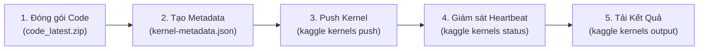

# Hướng Dẫn Sử Dụng Kaggle GPU Thay Thế Cho Google Colab (Kaggle Batch Runner Guide)

> **Mục tiêu:** Cung cấp giải pháp GPU dự phòng hoàn toàn miễn phí (30 giờ GPU/tuần với 2x NVIDIA T4 hoặc 1x P100) khi Google Colab hết compute unit hoặc gặp lỗi nghẽn dịch vụ (Service Unavailable 503). Hệ thống sử dụng chế độ **Headless Batch Execution** thông qua Kaggle CLI (`kaggle`), loại bỏ 100% rủi ro mất kết nối WebSocket của trình duyệt.

---

## 1. So Sánh Kiến Trúc: Colab CLI vs. Kaggle Batch Kernel

| Tiêu chí | Google Colab CLI | Kaggle Batch Kernel |
|---|---|---|
| **Hình thức chạy** | Interactive Session (Streaming WebSocket) | Headless Background Job (Batch Worker) |
| **Độ ổn định kết nối** | Dễ bị đứt gãy nếu mạng local chập chờn | Chạy độc lập trên hạ tầng Kaggle (tối đa 9–12h) |
| **Hạn mức miễn phí** | Phụ thuộc Compute Units (dễ cạn kiệt) | **30 giờ GPU / tuần** (Reset định kỳ hàng tuần) |
| **Phần cứng GPU** | L4 (24GB) / T4 (16GB) | **2x NVIDIA T4 (2x 16GB)** hoặc **1x NVIDIA P100 (16GB)** |
| **Lưu trữ NVMe** | ~78GB SSD tạm thời | ~20GB working directory + 73GB scratch |
| **Đường truyền mạng** | Nhanh (~100-300 MB/s tới HF) | Cực nhanh (~200-500 MB/s tới HF khi bật `enable_internet`) |

---

## 2. Chuẩn Bị & Xác Thực Kaggle CLI

Kaggle CLI đã được cài đặt sẵn trên máy lập trình (`kaggle 2.2.5`).

### 2.1. Vị trí khóa xác thực
- Khóa API Kaggle được lưu tại: `~/.kaggle/kaggle.json` hoặc `~/.kaggle/access_token`.
- Tài khoản cấu hình: `xunthanhh`.

### 2.2. Kiểm tra kết nối & danh sách Kernel
Chạy lệnh kiểm tra xác thực từ terminal:
```bash
python -m kaggle kernels list --mine
```
Nếu danh sách trả về các kernel hiện có (`xunthanhh/...`), xác thực đã sẵn sàng 100%.

---

## 3. Quy Trình Vận Hành Một Batch Kernel Trên Kaggle

Quy trình tự động hóa gồm **4 bước khép kín**:



### Bước 1: Đóng gói Codebase an toàn (`package_codebase`)
- Chỉ đóng gói các thư mục mã nguồn: `src/`, `configs/`, `scripts/`, `tests/`.
- **Tuyệt đối loại trừ:** `.git/`, `.cache/`, `data/`, `experiments/`, `weights/`, các file `.zip` khác để tránh phình dung lượng và lỗi zip đệ quy. Dung lượng gói code thông thường chỉ từ **0.5MB – 2MB**.

### Bước 2: Khởi tạo File Cấu Hình `kernel-metadata.json`
Mỗi tác vụ chạy ngầm trên Kaggle cần một thư mục staging chứa mã thực thi và file metadata:

```json
{
  "id": "xunthanhh/zalo-aic-lfm3-eval",
  "title": "Zalo AIC LFM3 Evaluation",
  "code_file": "kaggle_entrypoint.py",
  "language": "python",
  "kernel_type": "script",
  "is_private": "true",
  "enable_gpu": "true",
  "enable_tpu": "false",
  "enable_internet": "true",
  "dataset_sources": [],
  "competition_sources": [],
  "kernel_sources": [],
  "model_sources": []
}
```
> [!IMPORTANT]
> - `enable_gpu: "true"`: Bật tăng tốc GPU (T4/P100).
> - `enable_internet: "true"`: Bắt buộc bật để container tải weights và dữ liệu từ Hugging Face Hub.

### Bước 3: Đẩy Kernel lên Kaggle (`push`)
```bash
python -m kaggle kernels push -p <staging_directory>
```

### Bước 4: Giám sát Trạng thái (Polling & Watchdog)
Hệ thống poll định kỳ mỗi 15-30 giây qua lệnh:
```bash
python -m kaggle kernels status xunthanhh/<kernel-slug>
```
Các trạng thái vòng đời của Kernel:
- `queued`: Đang xếp hàng chờ cấp GPU (thường 5–30 giây).
- `running`: Đang huấn luyện / chạy ReAct đánh giá.
- `complete`: Thực thi thành công, kết quả đã sẵn sàng tải về.
- `error`: Gặp exception, xem log chi tiết qua `output`.

### Bước 5: Tải Kết Quả & Log Về Máy Local (`output`)
```bash
python -m kaggle kernels output xunthanhh/<kernel-slug> -p <output_directory>
```
Tất cả các file được lưu vào `/kaggle/working/` (ví dụ: `predictions.jsonl`, `metrics.json`, `run.log`) sẽ được tự động tải về thư mục máy local.

---

## 4. Quản Lý Dữ Liệu & Model Weights Qua Hugging Face (Zero Google Drive)

Tương tự như chỉ thị trên Colab, **Kaggle Kernel tuyệt đối không dùng Google Drive**. Toàn bộ dữ liệu lớn và checkpoint được trung chuyển qua Hugging Face Hub:

1. **Trong file thực thi trên Kaggle (`kaggle_entrypoint.py`):**
   ```python
   import os
   from huggingface_hub import snapshot_download, HfApi

   HF_TOKEN = os.environ.get("HF_TOKEN", "your_token_here")

   # Tải checkpoint hoặc dataset về NVMe SSD của Kaggle trong 5-10 giây:
   snapshot_download(
       repo_id="LiquidAI/LFM3-1.7B",
       local_dir="/kaggle/working/models/lfm3",
       token=HF_TOKEN
   )
   ```

2. **Đẩy từng checkpoint (checkpoint-<step>) ngược lên Hugging Face:**
   ```python
   # Lưu từng checkpoint riêng biệt (checkpoints/checkpoint-<step>) để không ghi đè lịch sử:
   api = HfApi()
   api.upload_folder(
       folder_path=f"/kaggle/working/experiments/checkpoints/checkpoint-{step}",
       path_in_repo=f"{exp_prefix}/checkpoints/checkpoint-{step}",
       repo_id="xunthanhh/zalo-aic-checkpoints",
       repo_type="model",
       token=HF_TOKEN
   )
   ```

---

## 5. Tự Động Hóa Bằng `scripts/kaggle_runner.py`

Repository đã tích hợp sẵn công cụ tự động hóa toàn bộ quy trình trên:

### 1. Kiểm tra kết nối GPU Kaggle (Ping Test):
```bash
python scripts/kaggle_runner.py ping
```
*Tác vụ này tạo một kernel siêu nhẹ kiểm tra CUDA, GPU name và trả về kết quả trong ~1-2 phút.*

### 2. Đóng gói mã nguồn sạch:
```bash
python scripts/kaggle_runner.py package
```

### 3. Khởi chạy đánh giá hoặc huấn luyện:
```bash
python scripts/kaggle_runner.py run --entry scripts/kaggle_eval_kernel.py --slug zalo-aic-eval-100 --timeout 1800
```

---

## 6. Lưu Ý Tối Ưu Hóa Riêng Cho GPU T4 Trên Kaggle

1. **Chuẩn độ chính xác:** T4 là kiến trúc Turing, luôn cấu hình `fp16: true` và `bf16: false`.
2. **Kích thước Batch & Memory:** Dùng `per_device_train_batch_size: 2`, `gradient_accumulation_steps: 8`, `gradient_checkpointing: true`.
3. **Giới hạn thời gian:** Mỗi session batch kernel được chạy liên tục tối đa **12 tiếng**, vượt xa nhu cầu đánh giá (vài phút) hoặc SFT 1 epoch (1.5 - 2 tiếng).
