# Kế Hoạch Tổng Thể Tối Đa Hóa Độ Chính Xác: Apex-MiniCPM5 (`openbmb/MiniCPM5-2B`)
**Ngày lập:** 10/11/2026  
**Mục tiêu:** Đưa độ chính xác End-to-End (`final_score`) trên tập Sealed Blind Dev (`299 mẫu`) và Private Test từ nền tảng `LFM3-1.7B` (`51.13%`) bứt phá lên vùng **> 78.0% – 83.5%** thông qua việc chuyển đổi sang kiến trúc **`openbmb/MiniCPM5-2B`** (`2.51B` tham số, SOTA phân khúc `<3B`), kết hợp tinh hoa từ repo chính thức [`references/tool_calling_repos/13_MiniCPM`](../../references/tool_calling_repos/13_MiniCPM) (nhánh `minicpm5-2b`) và 14 bài báo/repo SOTA về Agentic Tool-Calling.  
**Trạng thái:** Sẵn sàng Thực Thi (Implementation-Ready Master Plan).

---

## 1. Mục Tiêu Tối Thượng & Bảng Đối Chiếu Lợi Thế Kiến Trúc (`MiniCPM5-2B` vs `LFM3-1.7B`)

### 1.1. Tại sao chuyển sang `openbmb/MiniCPM5-2B` là bước ngoặt chiến lược?
Qua thực nghiệm trên `LFM3-1.7B` (SFT `51.13%`, Stage 3A GRPO 150 steps `50.55%`), chúng ta đã xác định rõ nút thắt cổ chai:
1. **Rào cản Kiến trúc Lai (`Lfm2ForCausalLM`):** LFM3 sử dụng cấu trúc Tri-Hybrid (Attention + ShortConv + SwiGLU) với 10 module nội bộ khác chuẩn (`in_proj`, `out_proj`, `w1`, `w2`, `w3`), không tương thích gốc với các nhân tăng tốc `FlashAttention-2/3`, `vLLM`, `SGLang RadixAttention`, hay `Unsloth` chuẩn nếu không vá thủ công.
2. **Thiếu hụt Tiên nghiệm Suy luận Sâu (`<think>`) và Agentic Prior:** `LFM3-1.7B` là mô hình đa ngôn ngữ tổng quát chưa trải qua giai đoạn hậu huấn luyện chuyên sâu (Deep-Thinking SFT + RL + On-Policy Distillation) trên hàng trăm nghìn quỹ đạo Agent đa bước.

Ngược lại, **`openbmb/MiniCPM5-2B`** (vừa phát hành trên nhánh [`minicpm5-2b`](../../references/tool_calling_repos/13_MiniCPM/README.md)) mang lại 5 lợi thế áp đảo:

| Tiêu chí Kỹ thuật | `LiquidAI/LFM2.5-1.2B` / `LFM3-1.7B` | `openbmb/MiniCPM5-2B` (`minicpm5-2b`) | Lợi thế Chiến thuật cho Zalo AI Challenge 2026 |
| :--- | :--- | :--- | :--- |
| **Kiến trúc Lõi (`model_type`)** | `Lfm2ForCausalLM` (Tri-Hybrid) | **`LlamaForCausalLM` chuẩn (42 tầng, GQA 16Q/2KV)** | Tương thích 100% nguyên bản (`trust_remote_code=False`) với `Transformers`, `TRL`, `PEFT`, `vLLM`, `SGLang`, `Unsloth`. |
| **Tổng Tham số / Phi nhúng** | `1.73B` tổng | **`2.51B` tổng (`1.98B` non-embedding)** | Tăng **+45% dung lượng biểu diễn** cho 35 ứng dụng tiếng Việt trong khi vẫn rất nhẹ (`~5.0 GB` VRAM ở `BF16`). |
| **Điểm chuẩn Suy luận & Agent** | Trung bình nhóm 2B (`~51.1`) | **SOTA tuyệt đối phân khúc 2B (`53.9` Avg)** | Vượt `Qwen3.5-4B` (`51.1`) và `Nanbeige4.1-3B` (`52.6`). Đạt `74.4` trên `TAU2-Bench` (Agentic Tool-Calling) và `62.2` trên `BFCL-v4`! |
| **Tiên nghiệm Huấn luyện (`Post-Training`)** | SFT tiêu chuẩn | **400B tokens Deep-Thinking SFT (`500K` mẫu Agent) + `JustRL II` + `16-Teacher OPD`** | Đã được chưng cất trực tiếp từ **5 giáo viên RL chuyên biệt về Agent/Tool-Calling** qua On-Policy Distillation (Reverse KL toàn từ vựng). |
| **Hệ sinh thái Checkpoint Mở** | Chỉ 1 bản Instruct | **4 bản: `Base`, `SFT` (trước RL), `Instruct` (sau RL+OPD), `DSpark` (Draft)** | Có sẵn **`MiniCPM5-2B-SFT`** (chưa bị co cụm entropy bởi RL) để fine-tune domain LifeMate cực kỳ mềm dẻo, và **`MiniCPM5-2B-DSpark`** để tăng tốc suy luận Speculative Decoding gấp ~2.2x! |

### 1.2. Ngân sách Tham số & Độ trễ (Tuân thủ Tuyệt đối `AGENTS.md`)

| Thành phần Hệ thống (Lúc Thi Đấu / Docker) | Mô hình Cụ thể | Số Tham số | Dung lượng VRAM (`BF16`) | Ghi chú Tuân thủ |
| :--- | :--- | :---: | :---: | :--- |
| **1. Mô hình Nhận dạng Giọng nói (ASR)** | `vinai/PhoWhisper-large` (CT2 INT8/FP16) | `1.54B` | `~3.1 GB` | Chuẩn hóa 16kHz + Whisper Prompting neo thực thể. |
| **2. Mô hình Ngôn ngữ Chính (Agent LLM)** | `openbmb/MiniCPM5-2B` (Đã gộp LoRA / Model Soup) | `2.51B` | `~5.0 GB` | `< 5.0B` giới hạn cứng cho LLM (`AGENTS.md` Mục 2.2). |
| **3. Mô hình Nháp Tăng tốc (`DSpark` - Tùy chọn)** | `openbmb/MiniCPM5-2B-DSpark` | `~0.18B` | `~0.4 GB` | Tăng tốc Speculative Decoding `block_size=7` giữ nguyên 100% đầu ra. |
| **4. Bộ Kiểm duyệt Biên (`Boundary Verifier`)** | `SmolLM2-360M` / `Qwen2.5-0.5B` (hoặc 0B nếu dùng Logit Gate nội tại) | `0.36B` | `~0.8 GB` | Kiểm định biên `ACT` vs `ASK` vs `OOS`. |
| **TỔNG CỘNG TOÀN HỆ THỐNG** | **ASR + Agent LLM + Auxiliary** | **`4.41B` – `4.59B`** | **`~9.3 GB` / `24 GB` (A30)** | **An toàn tuyệt đối `< 6.0B` tham số & dư `>14.5 GB` VRAM cho KV Cache 16K!** |

---

## 2. Đúc Kết Tinh Hoa Kỹ Thuật từ Repo `13_MiniCPM` (Nhánh `minicpm5-2b`)

Qua việc kiểm toán toàn bộ mã nguồn và tài liệu kỹ thuật trong [`references/tool_calling_repos/13_MiniCPM`](../../references/tool_calling_repos/13_MiniCPM), dưới đây là **6 bí quyết cốt lõi và các "Cạm bẫy Kỹ thuật" (Critical Gotchas)** bắt buộc phải tuân thủ khi huấn luyện và triển khai `MiniCPM5-2B`:

### 2.1. Công thức Hậu Huấn luyện 3 Tầng của OpenBMB (`SFT -> JustRL II -> OPD`)
Theo [`README.md`](../../references/tool_calling_repos/13_MiniCPM/README.md):
1. **Stage 1 — Deep-Thinking SFT (400B tokens):** Huấn luyện trên tập `UltraData-SFT-2605` (13M mẫu suy luận sâu có chuỗi `<think>...</think>`) cộng với **`UltraData-SFT-Agent-2609` (`500K` mẫu quỹ đạo Agent đa lượt)** sử dụng công cụ thực tế. Checkpoint xuất ra là **`openbmb/MiniCPM5-2B-SFT`**.
2. **Stage 2 — Domain-Specific `JustRL II` (`80K+` mẫu RL):** Huấn luyện 16 mô hình giáo viên chuyên biệt (5 mô hình STEM, **5 mô hình Agent**, 5 mô hình General, 1 mô hình Coding) bằng thuật toán Critic-based RL (`JustRL II`) giúp khám phá sâu hơn các chuỗi hành động dài.
3. **Stage 3 — On-Policy Distillation (`OPD`):** Hợp nhất cả 16 giáo viên RL vào một mô hình học sinh duy nhất (`openbmb/MiniCPM5-2B`). Học sinh tự sinh quỹ đạo on-policy của chính mình, và nhận tín hiệu lợi thế mức token (token-level advantage) từ **phân kỳ KL ngược trên toàn bộ từ vựng (Full-Vocabulary Reverse KL Divergence)** so với giáo viên miền tương ứng.
   - **Bài học xương máu cho dự án LifeMate:** Khi chúng ta fine-tune SFT quy mô lớn cho miền LifeMate (35 ứng dụng tiếng Việt), chúng ta cần đối chứng thực nghiệm cả **`openbmb/MiniCPM5-2B-SFT`** (chưa bị bó hẹp phân phối bởi RL, dễ học cấu trúc schema mới) và **`openbmb/MiniCPM5-2B`** (đã có năng lực Agent RL `TAU2-Bench = 74.4`), sau đó áp dụng chính kỹ thuật **On-Policy Distillation (OPD)** ở Pha 5 để gộp các chuyên gia mà không làm sụp đổ định dạng!

### 2.2. Định dạng Gọi Công cụ Nguyên bản: XML `<function>` & `<param>` (KHÔNG PHẢI JSON thuần)
Theo [`tool_parsers/minicpm5xml_tool_parser.py`](../../references/tool_calling_repos/13_MiniCPM/tool_parsers/minicpm5xml_tool_parser.py), `MiniCPM5-2B` **không** sinh `<tool_call>{"name": ...}</tool_call>` kiểu JSON-in-XML như Qwen/LFM3, mà được huấn luyện sâu trên **cú pháp XML phân cấp**:
```xml
<think>
1. Intent: Người dùng muốn đặt báo thức lúc 6 giờ 30 sáng mai.
2. State: Đã có thời gian rõ ràng "06:30", không thiếu tham số bắt buộc.
3. Decision: ACT -> gọi alarm.create_alarm.
</think>
<function name="alarm.create_alarm">
<param name="time">06:30</param>
<param name="label">Dậy tập thể dục</param>
</function>
```
**Lợi thế vượt trội của định dạng XML `<function><param>` đối với Tiếng Việt:**
- Loại bỏ hoàn toàn lỗi thoát chuỗi dấu ngoặc kép (`\"`) khi chuỗi tiếng Việt chứa tên bài hát, nội dung email/tin nhắn hoặc dấu câu phức tạp.
- Các giá trị kiểu `string` được trích xuất nguyên văn (hỗ trợ cả `<![CDATA[...]]>`), trong khi các kiểu `integer`, `number`, `boolean`, `array`, `object` được ép kiểu chính xác theo JSON Schema của công cụ thông qua hàm `_convert_param_value(raw_value, param_type)` (dùng `json.loads` với fallback sang `ast.literal_eval`).

### 2.3. Cạm bẫy Token Đặc biệt (`skip_special_tokens=False` & Chuẩn hóa `\u0120`)
Trong [`tool_parsers/minicpm5xml_tool_parser.py`](../../references/tool_calling_repos/13_MiniCPM/tool_parsers/minicpm5xml_tool_parser.py#L28-L41) và [`docs/deployment/sglang.md`](../../references/tool_calling_repos/13_MiniCPM/docs/deployment/sglang.md#L133), các kỹ sư OpenBMB cảnh báo một cạm bẫy cực kỳ quan trọng:
1. Các thẻ `<function`, `</function>`, `<param`, `</param>`, `<think>`, `</think>` liên quan mật thiết đến bảng special tokens của tokenizer MiniCPM5. Khi gọi `tokenizer.decode(...)` hoặc `sglang`/`vLLM`, **bắt buộc phải đặt `skip_special_tokens=False`** trước khi đưa chuỗi qua bộ phân tích công cụ (`ToolParser`), sau đó mới lọc bỏ `<|im_end|>` hoặc `<|endoftext|>`. Nếu đặt `skip_special_tokens=True`, các thẻ đóng/mở `<function>` có thể bị nuốt mất!
2. Đôi khi bộ giải mã SentencePiece/BPE của MiniCPM5 xuất ký tự khoảng trắng mức byte `\u0120` (`Ġ`) hoặc dính thẻ `<functionname=` / `<paramname=`. Bộ parser bắt buộc phải chạy bước tiền xử lý `_normalize_model_output()`:
   ```python
   normalized = model_output.replace("\u0120", " ")
   normalized = re.sub(r"<\s*function\s*name\s*=", "<function name=", normalized, flags=re.IGNORECASE)
   normalized = re.sub(r"<\s*param\s*name\s*=", "<param name=", normalized, flags=re.IGNORECASE)
   ```

### 2.4. Cạm bẫy `TRAIN_CHAT_TEMPLATE` khi Huấn luyện SFT với `TRL` (`assistant_only_loss=True`)
Theo [`skills/minicpm5-finetune-trl/SKILL.md`](../../references/tool_calling_repos/13_MiniCPM/skills/minicpm5-finetune-trl/SKILL.md) và [`docs/finetune/trl.md`](../../references/tool_calling_repos/13_MiniCPM/docs/finetune/trl.md):
- File `chat_template.jinja` gốc của `openbmb/MiniCPM5-2B` chứa logic đầy đủ để render danh sách `tools`, chế độ `enable_thinking=True`, và định dạng `<function><param>`, nhưng **không** chứa cặp thẻ `...` mà `TRL SFTConfig(assistant_only_loss=True)` yêu cầu.
- Nếu không có ``, `TRL` sẽ tính hàm mất mát (Cross-Entropy Loss) trên **toàn bộ prompt hệ thống + danh sách 35 công cụ + lịch sử hội thoại**, làm loãng gradient và khiến loss tăng ngược trên các adapter nhỏ!
- **Giải pháp chuẩn từ `13_MiniCPM`:**
  1. Khi chuẩn bị dữ liệu SFT hoặc tiền xử lý chuỗi hội thoại đa lượt (có `tools` và `tool` observations), ta dùng `tokenizer.apply_chat_template` gốc để kết xuất phần System Prompt (kèm định nghĩa `tools` chuẩn của MiniCPM5), hoặc sử dụng mẫu `TRAIN_CHAT_TEMPLATE` có gắn `...` bao quanh đúng phần nội dung sinh ra của `assistant` (`<think>...</think>\n<function ...>...</function>`).
  2. **QUY TẮC SỐNG CÒN:** Chỉ gán `tok.chat_template = MINI_CPM5_TRAIN_CHAT_TEMPLATE` **trong bộ nhớ RAM lúc huấn luyện**. **TUYỆT ĐỐI KHÔNG** lưu `chat_template` đã vá này đè lên đĩa khi xuất model! Khi gộp LoRA (`merge_and_unload`) hoặc chạy suy luận, luôn nạp lại `AutoTokenizer.from_pretrained("openbmb/MiniCPM5-2B")` nguyên bản để bảo toàn 100% logic tool-calling gốc.

### 2.5. Cấu hình LoRA Chuẩn Llama & Chế độ Suy luận `enable_thinking=True`
- **Target Modules chuẩn:** Vì `MiniCPM5-2B` là `LlamaForCausalLM` thuần khiết, danh sách module LoRA chuẩn là **7 lớp chiếu tuyến tính**:
  `["q_proj", "k_proj", "v_proj", "o_proj", "gate_proj", "up_proj", "down_proj"]`
- **Chế độ Suy luận (`enable_thinking`):** Khác với bản `1B` (hỗ trợ cả `Think` và `No-Think`), bản **`MiniCPM5-2B` được thiết kế chuyên biệt cho chế độ `enable_thinking=True`** (luôn suy luận `<think>...</think>` trước khi hành động). Khi đánh giá thi đấu (yêu cầu Deterministic Reproducibility theo `AGENTS.md`), ta sử dụng `enable_thinking=True` kết hợp giải mã tất định (`do_sample=False` / `temperature=0.0`) và giới hạn chiều dài chuỗi `<think>` có cấu trúc 4-Slot ($\le 90$ tokens) để vừa phát huy tối đa trí thông minh suy luận của `MiniCPM5-2B`, vừa giữ độ trễ mỗi lượt chỉ `~0.6s – 0.9s`.

---

## 3. Chẩn Đoán Nguyên Nhân Gốc Rễ & Cách `Apex-MiniCPM5` Phá Vỡ Trần `51.13%`

Dựa trên phân tích định lượng 299 mẫu Sealed Blind Dev từ lần chạy trước và báo cáo kiểm toán codebase, bảng dưới đây chỉ rõ 5 nút thắt đã kìm hãm hệ thống cũ ở mức `51.13%` và giải pháp triệt để trong kiến trúc `Apex-MiniCPM5`:

| STT | Nút thắt Cổ chai Cũ (`LFM3`) | Tác động Điểm số | Giải pháp Đột phá trong `Apex-MiniCPM5` | Kỳ vọng Tăng điểm (`Final Score`) |
| :-: | :--- | :---: | :--- | :---: |
| **1** | **Tự bắn vào chân ở Hậu xử lý (`sanitize_tool_call` & `contacts.search`)** | `-4.5%` đến `-6.0%` | • Sửa `sanitize_tool_call`: chỉ lọc bỏ tham số không bắt buộc khi giá trị rỗng/rác (`""`, `None`, `"unknown"`), **cấm xóa tham số hợp lệ** mà mô hình đã trích xuất đúng.<br>• Cắt hậu tố lịch sự tiếng Việt (`"ạ"`, `"nhé"`, `"giùm mình"`) khỏi `contacts.search(query=...)` khi khớp chuỗi con.<br>• Nâng cấp `x-ref` trong `ReActLoop` lên mức `<app>.<collection>` để không chặn nhầm lệnh ghi hợp lệ. | **`+5.0%` $\to$ `~56.1%`** |
| **2** | **Định dạng Gọi hàm & Tiên nghiệm Agent yếu của Base Model 1.7B** | `-7.0%` đến `-9.0%` | • Chuyển sang **`openbmb/MiniCPM5-2B`** (`2.51B`, `TAU2-Bench = 74.4`, `BFCL-v4 = 62.2`).<br>• Chuyển đổi toàn bộ bộ khung gọi hàm sang **Native XML `<function name=...><param name=...>`** của `MiniCPM5` với trình phân tích song ngữ (`minicpm5_parser.py`), triệt tiêu 100% lỗi cú pháp JSON tiếng Việt. | **`+6.5%` $\to$ `~62.6%`** |
| **3** | **Đói dữ liệu trên 25 ứng dụng Đuôi dài (`Long-tail Apps`) & Thiếu Khôi phục lỗi** | `-6.0%` đến `-8.0%` | • Tổng hợp **+3,500 quỹ đạo đa lượt chuẩn `APIGen-MT`** phủ kín 25 ứng dụng đuôi dài và kịch bản `Multi-Intent` (2–4 công cụ/lượt).<br>• Bổ sung **+1,200 mẫu `Recovery Augmenter`**: dạy mô hình xử lý khi `lookup/search` trả về `[]` hoặc nhiều ứng viên trùng tên. | **`+6.5%` $\to$ `~69.1%`** |
| **4** | **Nhầm lẫn Biên Quyết định `ACT` vs `ASK` (`38.53%`) và Tham số Tùy chọn** | `-5.0%` đến `-6.5%` | • Áp dụng suy luận có cấu trúc **`<think>` 4-Slot (`Tool-N1` + `ReAct`)** tận dụng năng lực `Deep-Thinking` nguyên bản của `MiniCPM5-2B`.<br>• Huấn luyện **Stage 2 Multi-Negative `When2Call` DPO (`Sigmoid + SFT`)** với 5 loại phản ví dụ trên cùng một prompt.<br>• Tích hợp cổng kiểm định **`Boundary Verifier`** kiểm tra chéo quyết định `ASK` vs `ACT`. | **`+5.5%` $\to$ `~74.6%`** |
| **5** | **Học Tăng cường Đơn bước (`Step GRPO`) thiếu Tương tác `SafeEnv` Đa lượt** | `-4.0%` đến `-6.0%` | • Khắc phục hiện tượng `reward_std = 0` (62% bước bị vô hiệu hóa ở LFM3) bằng **Dynamic Rollout Filtering (`LoopTool`)** + Cổng nhân **`step_gold_state_hash`**.<br>• Chuyển sang **Stage 3B Multi-Turn `SafeEnv` `GiGPO`** (chạy vòng lặp tương tác thật trong `SafeEnv` 6 bước, chấm thưởng trực tiếp bằng công thức `final_score` của Ban Tổ Chức).<br>• Chốt hạ bằng **Stage 3C On-Policy Distillation (`OPD`)** & **5-Fold Model Soup**. | **`+5.5%` $\to$ `~80.1%+`** |

---

## 4. Kiến Trúc Đích `Apex-MiniCPM5` (Hai Pha: Nhà Máy Huấn Luyện & Động Cơ Suy Luận)

```mermaid
flowchart TD
    subgraph OFFLINE["PHA I: NHÀ MÁY DỮ LIỆU & HẬU HUẤN LUYỆN 5 TẦNG TRÊN NVIDIA G4 (96GB VRAM)"]
        A["Audio Train (1,401 mẫu) + 5-Fold PhoWhisper OOF"] --> B["AURA Phonetic Confusion Matrix & ASR Noise Injector"]
        C["Schema 35 Apps + state.json (Train-Only)"] --> D["APIGen-MT & FunReason-MT Generator (+3,500 mẫu XML)"]
        B & D --> E["Kho Quỹ Đạo Chuẩn MiniCPM5 XML (9,200+ mẫu: <think> 4-Slot + <function><param>)"]
        E --> F["Stage 1: Curriculum SFT (TRL assistant_only_loss + 7-Module DoRA/LoRA r=64)"]
        F --> G["Stage 2: When2Call Multi-Negative DPO (Loss = Sigmoid + 0.2*SFT)"]
        G --> H["Stage 3A & 3B: Dynamic-Filtered Step GRPO + Multi-Turn SafeEnv GiGPO"]
        H --> I["Stage 3C: MiniCPM5 On-Policy Distillation (OPD) & LoopTool (3 Vòng)"]
        I --> J["Stage 4: 5-Fold Task-Vector Model Soup -> Apex-MiniCPM5-2B-Merged"]
    end

    subgraph ONLINE["PHA II: ĐỘNG CƠ SUY LUẬN ĐỊNH ĐỊNH OFFLINE TRONG DOCKER (< 4.6B Params, <= 4.5s/mẫu)"]
        K["Input Audio (.wav 16kHz)"] --> L["PhoWhisper-Large (1.54B) + Context Entity Biasing"]
        L --> M["Deterministic Entity Recovery + Context Prefix Optimizer"]
        M --> N["Apex-MiniCPM5-2B (2.51B) + DSpark Draft (0.18B) + Prefix Cache"]
        N --> O["MiniCPM5 XML Tool Parser (skip_special_tokens=False + Type Coercion)"]
        O --> P{"Boundary Verifier & Zero-Corruption Guard"}
        P -- "Hợp lệ (ACT)" --> Q["SafeEnv.validate() & SafeEnv.call()"]
        Q -- "Observation (JSON + Recovery Hint)" --> N
        P -- "Thiếu tham số bắt buộc (ASK)" --> R["sys.ask_missing_info"]
        P -- "Ngoài phạm vi (OOS)" --> S["Trả về []"]
        Q & R & S --> T["Final tool_calls + env.get_state_hash()"]
    end
```



---

## 5. Kế Hoạch Thực Thi Chi Tiết 8 Pha (Implementation-Ready Roadmap)

> [!IMPORTANT]
> **Nguyên tắc Thực thi Bất khả Xâm phạm:**
> 1. **Zero Local Heavy Compute:** Mọi tác vụ tải model `openbmb/MiniCPM5-2B`, tiền xử lý âm thanh, huấn luyện SFT/DPO/GRPO/OPD và đánh giá 299 mẫu Dev **bắt buộc** chạy trên GPU từ xa (Colab G4 96GB / L4 24GB) thông qua wrapper [`scripts/colab_runner.py`](../../scripts/colab_runner.py). Máy local chỉ soạn thảo mã nguồn và chạy `pytest` đơn vị nhẹ.
> 2. **Sealed Blind Dev (`299 mẫu`):** Tuyệt đối không đọc hay trích xuất quy tắc từ tập Dev (`configs/splits/dev_v1.json`). Mọi quyết định chọn siêu tham số dựa trên 5-Fold Cross-Validation của `1,401` mẫu Train.

---

### PHA 0: Phẫu Thuật Dứt Điểm Lỗi Tự Hủy Pipeline & Tích Hợp Bộ Khung `MiniCPM5` (Thắng Nhanh +5% Không Cần Train)

#### Task 0.1: Xây dựng Bộ Phân tích Công cụ Song ngữ `src/agent/minicpm5_parser.py`
Chuyển thể trực tiếp và nâng cấp [`references/tool_calling_repos/13_MiniCPM/tool_parsers/minicpm5xml_tool_parser.py`](../../references/tool_calling_repos/13_MiniCPM/tool_parsers/minicpm5xml_tool_parser.py) thành module độc lập không phụ thuộc vLLM, tích hợp nối tiếp vào [`src/agent/json_parser.py`](../../src/agent/json_parser.py):
- **File tạo mới:** `src/agent/minicpm5_parser.py`
- **File cập nhật:** `src/agent/json_parser.py`, `tests/test_minicpm5_parser.py`
- **Đặc tả kỹ thuật:**
  1. Hàm `normalize_minicpm5_output(text: str) -> str`:
     - Thay thế `\u0120` (`Ġ`) bằng khoảng trắng `" "`.
     - Chuẩn hóa các biến thể thẻ bị dính chữ do BPE: `<\s*function\s*name\s*=` $\to$ `<function name=`, `<\s*param\s*name\s*=` $\to$ `<param name=`, `<\s*/\s*function\s*>` $\to$ `</function>`, `<\s*/\s*param\s*>` $\to$ `</param>`.
  2. Hàm `extract_minicpm5_xml_calls(text: str, tool_schemas: dict[str, dict] | None = None) -> list[dict]`:
     - Tách bỏ khối `<think>...</think>` trước khi quét thẻ `<function>` (nhưng lưu lại nội dung `think` vào metadata log để phục vụ kiểm định `Boundary Verifier`).
     - Quét tất cả các khối `<function name="...">...</function>` (hỗ trợ gọi song song nhiều công cụ trong 1 lượt).
     - Với mỗi `<param name="key">raw_val</param>`, bóc tách `<![CDATA[...]]>` nếu có, sau đó tra cứu kiểu dữ liệu `param_type` trong `tool_schemas[func_name]["parameters"]["properties"][key]`:
       - Nếu `param_type == "string"`: giữ nguyên `raw_val` (chỉ cắt khoảng trắng đầu/cuối thừa do xuống dòng XML nếu có).
       - Nếu `param_type in ("integer", "number", "boolean", "array", "object")`: dùng `json.loads(raw_val)` với fallback `ast.literal_eval(raw_val)` giống hệt [`_convert_param_value`](../../references/tool_calling_repos/13_MiniCPM/tool_parsers/minicpm5xml_tool_parser.py#L140-L176).
  3. Tích hợp song ngữ vào `parse_tool_calls()` trong [`src/agent/json_parser.py`](../../src/agent/json_parser.py): tự động nhận diện cả định dạng XML `<function name=...>` của `MiniCPM5` lẫn định dạng JSON `<tool_call>{...}</tool_call>` để đảm bảo tương thích ngược 100%.

#### Task 0.2: Tích hợp Backend `MiniCPM5` trong `src/agent/llm_client.py` & `src/agent/prompt_builder.py`
- **File cập nhật:** [`src/agent/llm_client.py`](../../src/agent/llm_client.py), [`src/agent/prompt_builder.py`](../../src/agent/prompt_builder.py)
- **Đặc tả kỹ thuật:**
  1. Trong `TransformersBackend`:
     - Nạp `AutoModelForCausalLM` và `AutoTokenizer` với `trust_remote_code=False`, `torch_dtype=torch.bfloat16`, `attn_implementation="sdpa"` (hoặc `"flash_attention_2"`).
     - Khi gọi `tokenizer.apply_chat_template(...)`: truyền `tools=formatted_tools`, `add_generation_prompt=True`, `enable_thinking=True`.
     - **Bắt buộc khi giải mã (`decode`):** Đặt `skip_special_tokens=False` khi giải mã các token mới sinh ra:
       ```python
       raw_text = self.tokenizer.decode(output_ids[prompt_len:], skip_special_tokens=False)
       # Chỉ cắt bỏ token kết thúc lượt <|im_end|> và <|endoftext|>, giữ nguyên thẻ <function>, <param>, <think>
       clean_text = re.sub(r"(<\|im_end\|>|<\|endoftext\|>)+$", "", raw_text).strip()
       ```
  2. Hỗ trợ chuyển đổi mượt mà sang `VLLMBackend` / `SGLangBackend` với tham số `--tool-call-parser minicpm5` và `--speculative-draft-model-path openbmb/MiniCPM5-2B-DSpark`.

#### Task 0.3: Phẫu thuật 4 Lỗi Tự Hủy trong Pipeline Thực Thi (`Zero-Gold-Corruption`)
- **File cập nhật:** [`src/agent/tool_validator.py`](../../src/agent/tool_validator.py), [`src/agent/react_loop.py`](../../src/agent/react_loop.py), `scripts/eval_end_to_end.py`
- **Đặc tả kỹ thuật:**
  1. **Sửa `sanitize_tool_call()` trong [`src/agent/tool_validator.py`](../../src/agent/tool_validator.py):**
     - Chỉ loại bỏ một tham số không bắt buộc (`optional parameter`) khi giá trị của nó là rỗng hoặc placeholder rác (`None`, `""`, `"null"`, `"None"`, `"unknown"`, `"N/A"`, `[]`, `{}`).
     - **Tuyệt đối giữ nguyên** mọi tham số optional có giá trị thực tế hợp lệ theo schema (ví dụ: `notes`, `description`, `category`, `repeat`, `priority`) mà mô hình đã trích xuất từ lời nói của người dùng.
  2. **Sửa chuẩn hóa truy vấn tiếng Việt cho `contacts.search` trong `zaic_tools` / bộ đệm tiền thực thi:**
     - Trước khi truyền `query` vào `contacts.search` hoặc các hàm tìm kiếm danh bạ/nhạc, tự động tước bỏ các tiểu từ/hậu tố lịch sự cuối câu tiếng Việt (`" ạ"`, `" nhé"`, `" nha"`, `" với"`, `" giúp tôi"`, `" giùm mình"`, `" đi"`) và tiền tố danh xưng thừa (`"anh "`, `"chị "`, `"bạn "`, `"cô "`, `"chú "`) nếu truy vấn gốc không khớp chính xác nhưng bản đã tước hậu tố khớp trong danh bạ.
  3. **Sửa kiểm tra `x-ref` trong [`src/agent/react_loop.py`](../../src/agent/react_loop.py):**
     - Thay vì kiểm tra ở mức toàn ứng dụng (`app_name`), nâng cấp bảng ánh xạ phụ thuộc `x-ref` lên mức **`<app_name>.<collection_name>`** (ví dụ: chỉ bắt buộc gọi `contacts.search` khi tham số yêu cầu `contact_id`, không chặn các hàm ghi độc lập cùng ứng dụng).
  4. **Bộ nhớ đệm Đọc Lịch sử (`history_read_cache`):**
     - Khởi tạo `history_read_cache` từ `conversation_history` đầu vào để nếu lượt hội thoại trước đã gọi `get_*` / `list_*` / `search_*`, mô hình ở lượt hiện tại có thể thực thi ngay lệnh cập nhật mà không bị phạt lỗi thiếu lệnh đọc.

---

### PHA 1: Đo Điểm Chuẩn Zero-Shot `openbmb/MiniCPM5-2B` & Nâng Cấp Tầng ASR `PhoWhisper-Large`

#### Task 1.1: Chạy Đánh giá Zero-Shot / Few-Shot `openbmb/MiniCPM5-2B` trên GPU Từ Xa
- **Mục tiêu:** Đo lường ngay lập tức sức mạnh nguyên bản của `openbmb/MiniCPM5-2B` (sau khi đã vá Pha 0 và gắn `minicpm5_parser.py`) trên tập Validation OOF và tập Sealed Dev.
- **Lệnh thực thi (qua `scripts/colab_runner.py`):**
  ```bash
  python scripts/colab_runner.py --gpu L4 --name minicpm5-zeroshot \
    --cmd "python scripts/eval_end_to_end.py --model openbmb/MiniCPM5-2B --split dev"
  ```

#### Task 1.2: Hoàn thiện Tầng ASR `PhoWhisper-Large` 5-Fold OOF & `AURA` Phonetic Diff
- **Kế thừa & Tối ưu từ tài sản sẵn có:**
  - Chúng ta đã có bộ trọng số LoRA `PhoWhisper-large` và kịch bản sinh `train_oof_transcripts.jsonl`.
  - Bổ sung **Whisper Dynamic Context Biasing** (`src/asr/context_biasing.py`): trích xuất danh sách tên riêng trong `user_profile` (tên người thân, địa chỉ nhà/cơ quan) và tên 35 ứng dụng để bơm vào `initial_prompt` của `PhoWhisper-large`, giảm lỗi nhận dạng tên riêng tiếng Việt và từ mượn tiếng Anh (`Wi-Fi`, `Bluetooth`, `Playlist`, `Smart Home`).
  - Xây dựng ma trận nhầm lẫn âm vị **`AURA` (`src/asr/phonetic_noise.py`)** từ cặp `(gold_transcript, oof_asr_transcript)` trên 1,401 mẫu Train để tiêm nhiễu thực tế vào dữ liệu huấn luyện của `MiniCPM5-2B`.

---

### PHA 2: Nhà Máy Dữ Liệu Đa Lượt Chuẩn `MiniCPM5` XML (`<think>` 4-Slot + `<function><param>`)

> [!TIP]
> **Tại sao Pha 2 quyết định sự đột phá từ `51%` lên `>75%`?**
> Trong lần thử nghiệm trên `LFM3`, dữ liệu huấn luyện bị đóng khung ở định dạng JSON `<tool_call>` và thiếu hụt trầm trọng các mẫu đa bước cho 25 ứng dụng đuôi dài cũng như các mẫu tự phục hồi khi công cụ trả về kết quả rỗng. Ở Pha 2 này, toàn bộ kho dữ liệu được chuyển đổi sang **định dạng Native XML của `MiniCPM5-2B`** và làm giàu bằng 3 luồng dữ liệu chất lượng cao.

#### Task 2.1: Bộ Chuyển đổi Định dạng Chuẩn `MiniCPM5` (`scripts/build_minicpm5_dataset.py`)
Mỗi mẫu huấn luyện trong `data/sft_minicpm5_train.jsonl` được cấu trúc chính xác theo định dạng mà `openbmb/MiniCPM5-2B` đã học trên 400 tỷ token `UltraData-SFT-Agent-2609`:
```xml
<think>
1. Intent & App: Người dùng muốn chuyển 500 nghìn cho Minh qua ứng dụng banking.
2. History & Env State: Chưa có mã tài khoản (recipient_id) của Minh trong ngữ cảnh.
3. Parameter Audit: Để gọi banking.transfer_money cần recipient_id và OTP, trước hết phải tra cứu danh bạ/người thụ hưởng.
4. Decision: ACT -> gọi banking.search_beneficiary để tìm thông tin của Minh.
</think>
<function name="banking.search_beneficiary">
<param name="query">Minh</param>
</function>
```
Và khi công cụ trả về kết quả (`role: "tool"`), lượt tiếp theo của `assistant` tiếp tục suy luận `<think>` trên kết quả thực tế từ `SafeEnv` trước khi gọi hàm tiếp theo hoặc gọi `sys.ask_missing_info`.

#### Task 2.2: Tổng hợp `+3,500` Quỹ đạo Đa bước `APIGen-MT` cho 25 Ứng dụng Đuôi dài (`scripts/generate_apigen_mt_minicpm5.py`)
- **Quy trình 2 giai đoạn (`APIGen-MT` + `FunReason-MT`):**
  1. **Reverse-State Blueprinting (Chỉ chạy trên `train_environment/`):** Khởi tạo `SafeEnv` trên các bản chụp trạng thái của tập Train, lấy mẫu ngẫu nhiên các chuỗi hành động đa bước (`Read -> Compute -> Write`, `Multi-App Chaining` từ 2–4 công cụ) trên 25 ứng dụng ít xuất hiện trong tập gốc (`smart_home`, `food_delivery`, `ride_hailing`, `banking`, `health`, `music`, `calendar`, `notes`, `email`, v.v.).
  2. **Kiểm định Thực thi Kép (`Dual Execution Gate`):** Mọi quỹ đạo tổng hợp phải đi qua `SafeEnv.validate()` và `SafeEnv.call()` thành công 100%, tạo ra biến đổi `state_hash` khác trạng thái ban đầu (đối với `ACT`) hoặc xác nhận chính xác danh sách `missing_fields` (đối với `ASK`).

#### Task 2.3: Bộ Tăng cường Khôi phục Lỗi Thực thi (`src/agent/recovery_augmenter.py` — `+1,200` mẫu)
Huấn luyện `MiniCPM5-2B` xử lý 3 tình huống thực tế hay gặp nhất khi chạy vòng lặp `ReAct` trên tập Dev/Test:
1. **Tìm kiếm trả về rỗng (`[]`):** Khi `search(query="Anh Tuấn Phòng Kế Toán")` trả về `[]`, mô hình không được dừng cuộc chơi hoặc bịa ID (`"id_1"`), mà phải rút gọn từ khóa tìm kiếm về tên chính (`query="Tuấn"`) hoặc gọi hàm liệt kê danh sách (`list_*`).
2. **Tìm kiếm trả về nhiều kết quả trùng tên (`Disambiguation`):** Khi `search(query="Hùng")` trả về 2 người (`Nguyễn Văn Hùng` và `Trần Quốc Hùng`), mô hình kiểm tra ngữ cảnh (`conversation_history` / `user_profile`) hoặc gọi `sys.ask_missing_info` nếu thực sự mơ hồ.
3. **Nhiễu ASR trên Tên riêng & Thời gian (`AURA Augmentation`):** Nhân bản 30% mẫu huấn luyện với transcript đầu vào là bản OOF ASR của `PhoWhisper-large` nhưng nhãn đầu ra vẫn là chuỗi `<function><param>` chuẩn xác.

---

### PHA 3 (Stage 1): Huấn Luyện Giám Sát Phân Tầng (`Curriculum SFT`) Trên `openbmb/MiniCPM5-2B`

#### Task 3.1: Đối chứng Điểm xuất phát `MiniCPM5-2B-SFT` vs `MiniCPM5-2B`
- Repo `13_MiniCPM` cung cấp cả **`openbmb/MiniCPM5-2B-SFT`** (checkpoint ngay sau 400B tokens SFT, trước khi chạy RL) và **`openbmb/MiniCPM5-2B`** (checkpoint sau `JustRL II` + `OPD`).
- Chúng ta thực hiện một thử nghiệm nhanh 1 epoch trên Fold 0 để chọn nền tảng có điểm Validation OOF cao hơn làm xương sống chính.

#### Task 3.2: Kịch bản Huấn luyện `scripts/train_minicpm5_sft.py` (Chuẩn `13_MiniCPM` TRL Recipe)
Áp dụng chính xác công thức từ [`docs/finetune/trl.md`](../../references/tool_calling_repos/13_MiniCPM/docs/finetune/trl.md) với nâng cấp cho bài toán Đa lượt Tool-Calling:
- **Cấu hình LoRA / DoRA (`PEFT`):**
  ```python
  lora_config = LoraConfig(
      r=64,
      lora_alpha=128,
      lora_dropout=0.05,
      bias="none",
      use_dora=True,  # DoRA tách hướng và độ lớn trọng số, hội tụ vượt trội cho LlamaForCausalLM
      task_type="CAUSAL_LM",
      target_modules=["q_proj", "k_proj", "v_proj", "o_proj", "gate_proj", "up_proj", "down_proj"],
  )
  ```
- **Cấu hình Mask Loss Chỉ Trên Assistant (`assistant_only_loss=True`):**
  - Mở rộng `TRAIN_CHAT_TEMPLATE` của `13_MiniCPM` để hỗ trợ đầy đủ 4 vai trò (`system`, `user`, `assistant`, `tool`):
    ```python
    MINICPM5_AGENT_TRAIN_TEMPLATE = (
        "{{- bos_token }}"
        ""
        ""
        "{{- '<|im_start|>system\\n' + message['content'] + '<|im_end|>\\n' }}"
        ""
        "{{- '<|im_start|>user\\n' + message['content'] + '<|im_end|>\\n' }}"
        ""
        "{{- '<|im_start|>user\\n<tool_response>\\n' + message['content'] + '\\n</tool_response><|im_end|>\\n' }}"
        ""
        "{{- '<|im_start|>assistant\\n' }}"
        ""
        "{{- message['content'] + '<|im_end|>' }}"
        ""
        "{{- '\\n' }}"
        ""
        ""
        ""
        "{{- '<|im_start|>assistant\\n' }}"
        ""
    )
    ```
  - **Bảo vệ Tokenizer Gốc:** Sau khi `trainer.train()` hoàn tất, lưu riêng adapter (`trainer.model.save_pretrained(...)`), và khi gộp model (`merge_and_unload`), nạp lại `AutoTokenizer.from_pretrained("openbmb/MiniCPM5-2B")` nguyên bản để lưu kèm.
- **Lịch trình 2 Giai đoạn (`Curriculum SFT` trên NVIDIA G4 96GB):**
  - **Epoch 1–2 (Nền tảng Đa ứng dụng):** Huấn luyện trên toàn bộ `9,200` mẫu (`Train Gốc + APIGen-MT + Recovery + AURA`) với `lr = 1.5e-4`, `per_device_train_batch_size = 8`, `gradient_accumulation_steps = 4` (Effective Batch Size = 32), `max_length = 8192`, `bf16 = True`.
  - **Epoch 3 (Annealing Chất lượng cao):** Tinh chỉnh trên các mẫu quỹ đạo thực thi hoàn hảo và biên `ASK`/`ACT` khó với `lr = 3e-5` (Cosine decay về `0`).

---

### PHA 4 (Stage 2): `When2Call` Multi-Negative DPO (`Loss = Sigmoid + 0.2 * SFT`)

Giải quyết triệt để điểm yếu lớn nhất của các hệ thống Tool-Calling: **nhầm lẫn giữa `ACT` và `ASK` (`38.53%`) và bịa đặt tham số tùy chọn (`Optional-Arg Hallucination`)**.

#### Task 4.1: Xây dựng Tập Dữ liệu Đối kháng 5 Chiều (`scripts/build_minicpm5_dpo_pairs.py`)
Cho mô hình Stage 1 SFT chạy sinh mẫu trên 5-Fold OOF và kết hợp bộ tạo nhiễu có kiểm soát để tạo **8,000 cặp `(prompt, chosen, rejected)`** chuẩn XML `<function><param>`, bao phủ 5 kịch bản lỗi:
1. **Cặp 1 (`False-ACT on Missing Required Arg`):** Câu nói thiếu thông tin bắt buộc (VD: *"Chuyển tiền cho Tuấn"* thiếu `amount`).
   - `chosen`: `<think>...Thiếu amount -> ASK</think>\n<function name="sys.ask_missing_info">...</function>`
   - `rejected`: `<think>...</think>\n<function name="banking.transfer"><param name="amount">100000</param>...</function>` (Bịa số tiền).
2. **Cặp 2 (`False-ASK on Optional Arg`):** Câu nói đã đủ tham số bắt buộc, chỉ khuyết tham số tùy chọn (`notes`, `description`).
   - `chosen`: Thực thi lệnh `ACT` ngay.
   - `rejected`: Gọi `sys.ask_missing_info` đòi tham số không bắt buộc.
3. **Cặp 3 (`Optional-Arg Omission vs Hallucination`):**
   - `chosen`: Chỉ truyền đúng các `<param>` có căn cứ trong lời nói hoặc truyền thêm tham số optional khi người dùng thực sự nói tới.
   - `rejected`: Bỏ sót tham số optional mà người dùng đã nói rõ, hoặc tự bịa giá trị mặc định sai.
4. **Cặp 4 (`Blind Write without Read/Search`):**
   - `chosen`: Gọi `<function name="contacts.search">` hoặc `<function name="notes.list_notes">` ở Bước 1.
   - `rejected`: Gọi thẳng hàm xóa/sửa với ID tự chế (`"1"`, `"note_01"`).
5. **Cặp 5 (`False-ACT on Out-of-Scope`):**
   - `chosen`: Suy luận `<think>...Không có ứng dụng hỗ trợ -> OOS</think>` và trả lời lịch sự không sinh thẻ `<function>`.
   - `rejected`: Cố tình ép gọi một công cụ gần giống.

#### Task 4.2: Huấn luyện `scripts/train_minicpm5_dpo.py`
- Sử dụng `TRL DPOTrainer` với hàm mất mát lai **RPO (`loss_type=["sigmoid", "sft"]`, `loss_weights=[1.0, 0.2]`, `beta=0.1`, `lr=5e-6`, 1 epoch)**.
- Thành phần `0.2 * SFT_loss` giữ cho xác suất sinh chuỗi `<think>` và thẻ XML `<function><param>` của `chosen` không bị suy giảm trong quá trình đẩy xa `rejected`.

---

### PHA 5 (Stage 3A, 3B & 3C): Học Tăng Cường Đa Lượt Thực Thi `SafeEnv` (`GiGPO`) & Chưng Cất On-Policy (`OPD`)

> [!WARNING]
> **Bài học trực tiếp từ lần chạy GRPO trên LFM3 (`50.55%`):**
> Ở lần chạy trước, 62% số bước huấn luyện có `reward_std = 0.0` (do cả 4 nghiệm sinh ra đều giống nhau trên các câu dễ), dẫn đến gradient bằng 0, trong khi các câu đa bước lại chỉ được chấm ở từng bước tĩnh mà không chạy tiếp trong `SafeEnv`. Trong Pha 5 cho `MiniCPM5-2B`, chúng ta khắc phục triệt để bằng **3 cải tiến cấp độ nghiên cứu SOTA**:

#### Task 5.1 (Stage 3A): Step-GRPO có Lọc Động (`Dynamic Zero-Variance Filtering`) & Cổng Nhân `step_gold_state_hash`
- **File cập nhật:** `scripts/build_grpo_dataset.py`, `src/training/grpo_rewards.py`, `scripts/train_minicpm5_grpo.py`
- **Cải tiến 1 — `Dynamic Rollout Filtering` (`LoopTool`):** Trước hoặc trong khi huấn luyện, loại bỏ ngay các bước có phương sai phần thưởng bằng 0 (`std(R) == 0` khi cả $G=8$ nghiệm đều đạt điểm tối đa `1.0`), chỉ tập trung 100% bước cập nhật gradient vào **nhóm câu khó có phân hóa đúng/sai** (`0 < accuracy < 1`).
- **Cải tiến 2 — Cổng Nhân Trạng Thái Môi Trường (`step_gold_state_hash` Gate):**
  Trong `build_grpo_dataset.py`, ghi lại chính xác mã băm `step_gold_state_hash = env.get_state_hash()` sau khi thực thi bước Gold $t$. Trong hàm thưởng `execution_aware_step_reward`:
  $$R_{\text{step}}(y_i) = \left(0.25 \cdot R_{\text{xml\_format}} + 0.35 \cdot R_{\text{arg\_F1}}\right) \times \mathbb{I}[\text{valid\_schema}] + 0.40 \cdot \mathbb{I}\left[\text{hash}(\text{SafeEnv}(s_t, y_i)) == \text{step\_gold\_state\_hash}\right]$$
  Nếu mô hình gọi sai tham số khiến trạng thái `SafeEnv` lệch khỏi `step_gold_state_hash`, nó mất ngay `0.40` điểm thưởng, buộc gradient phải hội tụ vào tính chính xác tuyệt đối của tham số!

#### Task 5.2 (Stage 3B): Online Multi-Turn `SafeEnv` Rollout `GiGPO` (`scripts/train_minicpm5_gigpo.py`)
- Thay vì cắt rời từng bước, với mỗi mẫu hội thoại $x$ trong tập các câu đa bước khó (`Hard Multi-Turn Subset`, ~450 mẫu):
  1. Khởi tạo $G = 6$ bản sao môi trường `SafeEnv` song song trên GPU G4.
  2. Cho `MiniCPM5-2B` chạy vòng lặp tương tác đa lượt (tối đa 6 bước: `Generate XML -> Parse -> SafeEnv.call() -> Append Observation -> Generate Next Step`) cho đến khi kết thúc.
  3. **Hàm thưởng Cuối kỳ (`Terminal Reward`) khớp 100% công thức chấm thi của Zalo AI Challenge:**
     $$R_{\text{traj}}(\tau_i) = 0.50 \cdot \text{ToolCall\_F1}(\tau_i, \tau^*) + 0.50 \cdot \mathbb{I}\left[\text{final\_state\_hash}(\tau_i) == \text{gold\_state\_hash}\right] - 0.15 \cdot N_{\text{invalid\_calls}}(\tau_i)$$
  4. **Lợi thế Hai Tầng (`GiGPO` Step + Episode Advantage):** Kết hợp lợi thế toàn quỹ đạo $A_{\text{episode}}$ với lợi thế nhóm bước $A_{\text{step}}$ tại các trạng thái môi trường trùng nhau (ví cùng gọi `search` ở bước 1 nhưng bước 2 rẽ nhánh khác nhau).

#### Task 5.3 (Stage 3C): Chưng Cất Chính Sách Nội Tại (`MiniCPM5 On-Policy Distillation - OPD`)
Áp dụng đúng vũ khí bí mật đã giúp `openbmb/MiniCPM5-2B` đạt ngôi vương 2B (theo [`README.md`](../../references/tool_calling_repos/13_MiniCPM/README.md)):
- Sau khi có mô hình chuyên gia SFT/DPO (mạnh về độ phủ từ vựng và tham số tùy chọn) và mô hình chuyên gia RL `GiGPO` (mạnh về biên quyết định `ASK`/`OOS` và chuỗi đa bước), ta dùng chính kỹ thuật **On-Policy Distillation (OPD)** với hàm mục tiêu **Reverse KL trên các quỹ đạo thực thi đúng (`Verified Rollouts`)** để hợp nhất ưu điểm của cả hai mà không làm giảm độ mượt của chuỗi `<think>`.

---

### PHA 6 (Stage 4): Vòng Lặp Khép Kín `LoopTool` (3 Chu Kỳ) & Hợp Nhất `5-Fold Model Soup`

1. **Khai phá Dữ liệu Khó Tự Cải Thiện (`LoopTool` - `scripts/run_looptool_cycle.py`):**
   - Chạy đánh giá Out-of-Fold trên toàn bộ 1,401 mẫu Train.
   - Thu thập tất cả các mẫu có `final_score < 1.0` (`Failure Cases`).
   - Dùng cơ chế **Best-of-$N$ ($N=8$) có Kiểm định `SafeEnv`** kết hợp sửa lỗi có hướng dẫn để tìm ra quỹ đạo XML `<think> + <function><param>` đạt `state_match = 1.0`, đưa ngược vào tập SFT/DPO của chu kỳ kế tiếp.
2. **Hợp nhất Trọng số Đa Gấp (`5-Fold Task-Vector Model Soup` - `scripts/merge_minicpm5_soup.py`):**
   - Huấn luyện 5 adapter trên 5 Fold (mỗi Fold giữ lại 20% Train để kiểm định sớm, sử dụng 80% còn lại để train).
   - Hợp nhất 5 bộ trọng số $\theta_1, \dots, \theta_5$ bằng phương pháp **TIES-Merging / Weighted Task-Vector Averaging** (trọng số tỷ lệ thuận với điểm Validation OOF của từng Fold):
     $$\theta_{\text{Apex}} = \theta_{\text{Base}} + \sum_{k=1}^{5} w_k \cdot (\theta_k - \theta_{\text{Base}}), \quad \sum_{k=1}^{5} w_k = 1$$
   - Giúp tăng **+1.5% – 2.2% `final_score`** trên tập dữ liệu ẩn nhờ triệt tiêu phương sai ngẫu nhiên của từng Fold mà **không tốn thêm bất kỳ byte VRAM hay mili-giây độ trễ nào** lúc suy luận!

---

### PHA 7: Động Cơ Suy Luận Siêu Tốc (`vLLM` / `SGLang` + `DSpark` Speculative Decoding + `Boundary Verifier`)

Để đảm bảo thời gian xử lý mỗi mẫu trên 1x NVIDIA A30 (24GB VRAM) chỉ tốn **`1.8s – 3.5s`** (nhanh gấp 8–10 lần giới hạn 30 giây của Ban Tổ Chức):

1. **Tăng tốc Giải mã Nháp Không Mất Mát (`DSpark Speculative Decoding`):**
   - Tận dụng mô hình nháp chính thức [`openbmb/MiniCPM5-2B-DSpark`](https://huggingface.co/openbmb/MiniCPM5-2B-DSpark) từ repo `13_MiniCPM` với `block_size = 7`.
   - Vì giải mã nháp (Speculative Decoding) được kiểm tra xác nhận bởi chính `Apex-MiniCPM5-2B` ở mỗi bước với `temperature = 0.0`, kết quả đầu ra **giống hệt 100% (bit-exact / token-exact)** so với giải mã tự hồi quy thông thường nhưng tốc độ sinh chuỗi `<think>` + `<function><param>` nhanh gấp **~2.0x – 2.4x**!
2. **Bộ Nhớ Đệm Tiền Tố (`RadixAttention / Automatic Prefix Caching`):**
   - Sắp xếp cố định thứ tự 35 ứng dụng trong System Prompt để tiền tố hệ thống (`~2,800 tokens`) được lưu cố định trên KV Cache xuyên suốt mọi lượt gọi của vòng lặp `ReAct`.
3. **Cổng Kiểm Định Biên Quyết Định (`Boundary Verifier` & Deterministic Guardrails):**
   - Trước khi phát lệnh cuối cùng ra môi trường `SafeEnv`:
     - Nếu mô hình dự đoán `ACT`: kiểm tra tất cả tham số `required` trong JSON Schema đã có mặt và không phải giá trị bịa đặt (đối chiếu số tiền/thời gian/tên riêng với transcript và kết quả `Observation` trước đó).
     - Nếu mô hình dự đoán `ASK` (`sys.ask_missing_info`): đối chiếu danh sách `missing_fields` với tập `required` của schema công cụ để loại bỏ mọi tham số `optional` bị hỏi nhầm.

---

## 6. Lộ Trình Thực Thi Trên GPU NVIDIA G4 (`96GB VRAM`) & Dự Toán Compute Units

Hiện tại tài khoản Colab Pro+ của chúng ta đang có sẵn **`422.91 CU`** (burn rate hiện tại = `0.00/hr`). Với sức mạnh của 1x **NVIDIA RTX PRO 6000 Blackwell Server Edition (G4 - 96GB VRAM)** (~`7.5 CU/giờ`), toàn bộ kế hoạch từ Pha 0 đến Pha 7 chỉ tiêu tốn khoảng **`55 – 75 CU`** (chỉ chiếm `<18%` ngân sách hiện có):

| Giai đoạn | Nội dung Công việc Chính | Môi trường Thực thi | Thời gian Ước tính | Chi phí CU Dự kiến | Điểm `Final Score` Kỳ vọng (Dev) |
| :--- | :--- | :---: | :---: | :---: | :---: |
| **Bước 1 (Pha 0 + Pha 1)** | • Viết `src/agent/minicpm5_parser.py` & cập nhật `llm_client.py` cho `MiniCPM5-2B`.<br>• Phẫu thuật 4 lỗi `sanitize_tool_call`, `contacts.search`, `x-ref`, `history_cache` + chạy `pytest` local.<br>• Đánh giá lại LFM3 (sau khi vá Pha 0) & Đánh giá Zero-Shot `openbmb/MiniCPM5-2B` trên Dev. | Local Code + Colab G4/L4 | ~35 phút | `~3.5 CU` | `51.13%` $\to$ **`56.5%+`** (Chỉ nhờ vá lỗi & đổi model) |
| **Bước 2 (Pha 2)** | • Chuyển đổi kho dữ liệu sang định dạng Native XML `<think>` 4-Slot + `<function><param>`.<br>• Sinh `+3,500` quỹ đạo `APIGen-MT` (25 long-tail apps) + `+1,200` mẫu `Recovery Augmenter` + `AURA` ASR noise. | Colab G4 (96GB) | ~1.5 giờ | `~11.0 CU` | — (Xây dựng kho `9,200+` mẫu XML chuẩn) |
| **Bước 3 (Pha 3 - Stage 1 SFT)** | • Đối chứng nhanh `MiniCPM5-2B-SFT` vs `MiniCPM5-2B`.<br>• Huấn luyện Curriculum SFT (3 Epochs, DoRA/LoRA `r=64`, `assistant_only_loss=True` với `MINICPM5_AGENT_TRAIN_TEMPLATE`).<br>• Đánh giá 299 mẫu Sealed Dev. | Colab G4 (96GB) | ~1.5 giờ | `~11.5 CU` | **`68.0% – 72.5%`** |
| **Bước 4 (Pha 4 - Stage 2 DPO)** | • Sinh 8,000 cặp phản ví dụ 5 chiều (`When2Call` + `Optional-Arg` + `Write-Before-Read`).<br>• Huấn luyện Multi-Negative DPO (`Sigmoid + 0.2*SFT`).<br>• Đánh giá 299 mẫu Sealed Dev. | Colab G4 (96GB) | ~1.2 giờ | `~9.0 CU` | **`73.5% – 76.5%`** |
| **Bước 5 (Pha 5 - Stage 3 RL + OPD)** | • Chạy Dynamic-Filtered Step GRPO + Multi-Turn `SafeEnv` `GiGPO` (cổng `step_gold_state_hash` + `Terminal F1/State Reward`).<br>• Chưng cất On-Policy Distillation (`OPD`). | Colab G4 (96GB) | ~2.0 giờ | `~15.0 CU` | **`77.5% – 80.5%`** |
| **Bước 6 (Pha 6 & 7)** | • Vòng lặp `LoopTool` + Hợp nhất `5-Fold Model Soup`.<br>• Tích hợp `DSpark` Speculative Decoding & Đóng gói kiểm thử cuối cùng. | Colab G4 (96GB) | ~1.5 giờ | `~11.5 CU` | **`80.0% – 83.5%+`** |
| **TỔNG CỘNG** | **Toàn trình từ Pha 0 đến Đỉnh cao `Apex-MiniCPM5`** | **G4 96GB** | **~8.3 giờ** | **`~61.5 CU` / `422.91 CU`** | **Mục tiêu: `> 80%`** |

---

## 7. Danh Mục Kiểm Tra Chất Lượng (Quality Gates Trước Mỗi Bước Chuyển Pha)

1. **Gate 0 (Unit Tests 100% Pass):** Toàn bộ bài kiểm thử cho `minicpm5_parser.py` (xử lý `\u0120`, `<![CDATA[...]]>`, ép kiểu `int/float/bool/list/dict`, giữ nguyên tham số optional hợp lệ trong `sanitize_tool_call`) phải vượt qua `pytest` trên máy local trước khi bật GPU Colab.
2. **Gate 1 (Bảo toàn `chat_template` gốc):** Bắt buộc kiểm tra tự động sau mỗi lần lưu checkpoint SFT/DPO/GRPO rằng file `tokenizer_config.json` / `chat_template.jinja` trong thư mục model đã gộp là bản gốc của `openbmb/MiniCPM5-2B` (hỗ trợ đầy đủ `tools` và `enable_thinking`), tuyệt đối không bị lưu đè bởi `MINICPM5_AGENT_TRAIN_TEMPLATE`.
3. **Gate 2 (Monotonic Metric Improvement):** Mỗi tầng hậu huấn luyện (`SFT -> DPO -> GiGPO -> OPD -> Model Soup`) phải chứng minh sự cải thiện đơn điệu trên `final_score` và đặc biệt là hai nhóm chỉ số nhạy cảm nhất: `ask_score` (mục tiêu từ `38.5%` lên `>72%`) và `act_state_match` (mục tiêu từ `49.2%` lên `>78%`).
4. **Gate 3 (Zero Orphaned GPU):** Mọi lệnh chạy từ xa đều bọc trong `scripts/colab_runner.py` tự động tải toàn bộ trọng số `.safetensors` và báo cáo JSON về `experiments/exp_YYYYMMDD_<name>/` rồi tắt máy ảo G4 ngay lập tức.
