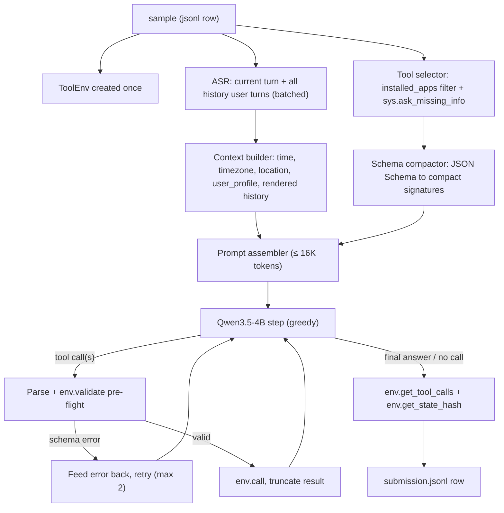

# Design Spec: Baseline Pipeline — Qwen3-ASR + Qwen3.5-4B ReAct Agent

- **Date:** 2026-11-03
- **Status:** Draft — awaiting user review
- **Depends on:** [Project foundation spec](2026-11-03-project-foundation-and-agent-standards-design.md), [AGENTS.md](../../AGENTS.md)

---

## 1. Goal

Build a measurable, reproducible end-to-end baseline for LifeMate:
`audio (+ history audio) → ASR → tool selection → Qwen3.5-4B ReAct loop over zaic_tools.ToolEnv → tool_calls + state_hash`,
together with a local evaluation harness that reproduces the official metric, so every later optimization is measured against the same yardstick.

## 2. Facts from the data (measured on `train` / `public_test`)

| Fact | Value | Design consequence |
|---|---|---|
| Train samples | 1,545 (public_test: 634) | Hold out a stratified dev split from train. |
| Catalog | 46 apps, 147 tools (incl. `sys.ask_missing_info`) | Tool selection is required. |
| Installed apps / sample | min 3, avg 9.2, max 18 | Hard filter by `installed_apps` is the first gate. |
| Tools / sample after filter | min 8, avg 32.5, max 62 | Compact signatures fit in 16K; retrieval is an optimization, not a baseline need. |
| Gold calls / sample | 0: 111, 1: 369, 2: 428, 3: 359, 4: 161, 5: 107, 6: 10 | Loop needs up to ~8 steps; 7% out-of-scope. |
| `sys.ask_missing_info` samples | 217 (14%) | Must be a first-class behaviour in the prompt. |
| Samples with history | train 1,018 (66%), public_test 419 (66%) | History handling is core, not an edge case. |
| History user turns in **test** | audio path only, **no `audio_text`**; up to 12 turns | ASR must transcribe every history user turn (batched). |
| History assistant turns | `text` + `tool_calls` (+ usually `tool_results`) | Render prior calls/results into the prompt; never re-execute them (state already includes them). |

Environment facts (from `zaic_tools/README.md`):
- A call is rejected (`ok: false`) **only** on schema errors; rejected calls are still logged and count as unmatched (`U`) in the metric.
- `env.validate()` checks schema without executing or logging → use it as a free pre-flight check.
- Business failures (unknown ID, insufficient balance) return `ok: true, done: false` and are logged.
- `env.get_state()` is allowed **on train only** (debug / evaluation), never at inference.

## 3. Model selection & parameter budget (HARD GATE)

Competition limits: total system < 6B params; LLM < 5B params, context ≤ 16,384 tokens.

Publicly reported sizes (must be re-verified by counting tensors, see §9 Phase 0):

| Component | Reported total params | Notes |
|---|---|---|
| Qwen3-ASR-0.6B | ~0.6–0.94B | Qwen3-0.6B decoder + audio encoder |
| Qwen3-ASR-1.7B | ~2.0–2.3B | Qwen3-1.7B decoder + ~300M AuT encoder |
| Qwen3.5-4B (full, with vision tower) | ~4.54–4.7B | ~0.33B vision encoder |
| Qwen3.5-4B (text-only, vision tower removed) | ~4.2B | Text path is all we need |

Combinations:

| Combo | Estimated total | Verdict |
|---|---|---|
| **ASR-0.6B + Qwen3.5-4B text-only** | ~4.8–5.1B | ✅ **Primary baseline** |
| ASR-0.6B + Qwen3.5-4B with vision | ~5.2–5.6B | ⚠️ Legal but wasteful; drop vision tower |
| ASR-1.7B + Qwen3.5-4B (any) | ~6.2–7.0B | ❌ **Exceeds 6B — not submittable** |

Decision:
- **Submission system:** Qwen3-ASR-0.6B + Qwen3.5-4B (text-only weights).
- **Qwen3-ASR-1.7B** is used **only during development** as an ASR upper-bound reference (WER comparison). It must never appear in the Docker image.
- Released before 26 Oct 2026 (Qwen3-ASR: Jan 2026; Qwen3.5-4B: Mar 2026); Apache-2.0 licences — re-check model cards in Phase 0.

## 4. Pipeline architecture

### 4.1 Stage 1 — ASR (`src/asr/`)
- Engine: Qwen3-ASR-0.6B, greedy decoding, language forced to Vietnamese.
- Input: current-turn wav + every history user-turn wav, **one batched call** per sample.
- Output: `list[Transcript(turn_index, text, latency_ms)]`.
- Optional (optimization phase): context biasing with app names / user_profile strings via the model's context prompt.
- No text normalisation in baseline (numbers like "hai mươi sáu độ" are left to the LLM); measure first.

### 4.2 Stage 2 — Tool selection & schema compaction (`src/agent/`)
- Gate 1 (rule, always): keep only tools of `context.installed_apps` plus `sys.ask_missing_info`. Calling a non-installed tool is a guaranteed rejected call.
- Gate 2 (baseline): pass **all** remaining tools (avg 32, max 62) using the model's native `tools=` chat-template format.
- Compaction: strip verbose fields, keep name, description, param types, enums, `required`, and short notes for `x-ref` ("ID from <tool>"), `x-one-of`, `x-match: fuzzy`.
- Budget check: assert prompt ≤ ~12K tokens to leave room for 4–8 loop steps within 16K.

### 4.3 Stage 3 — Prompt (`src/agent/prompts.py`)
System prompt rules (Vietnamese + English keywords):
1. Act only via tools; never invent IDs — read first (`get_status`, `list`, `search`) then write using returned IDs.
2. Resolve relative time ("mai", "3 giờ chiều") from `current_time` + `timezone`; addresses from `user_profile` / `location`.
3. If a required parameter cannot be found in the utterance, context, history, or tool results → call `sys.ask_missing_info(tool_name, params)` and stop.
4. If no installed tool can serve the request → make **no** call.
5. History calls were already executed; do not repeat them.
6. Stop when the request is fulfilled; do not add unrequested calls (they lower precision).

History rendering: user turns as transcripts; assistant turns as text + compact `tool_calls` + truncated `tool_results`.

### 4.4 Stage 4 — ReAct loop (`src/agent/react_loop.py`)
- Generation: greedy (`temperature=0`), non-thinking mode in baseline; thinking mode with a token budget is an experiment.
- Native tool-call parsing (Qwen chat template); fallback JSON extractor for malformed output.
- Pre-flight: every parsed call goes through `env.validate()`. On error, return the error to the model as a tool message and retry (max 2) **without** calling `env.call` — avoids logged rejected calls.
- Execute valid calls with `env.call()`; truncate large results (e.g. lists > N items) before appending.
- Stop conditions: model returns no tool call; `sys.ask_missing_info` was called; max 8 steps; wall-clock budget 25 s.
- Safety: one ToolEnv per sample; only `validate`, `call`, `get_tool_calls`, `get_state_hash` reachable through `src/env/` wrapper.

### 4.5 Stage 5 — Output & submission (`scripts/make_submission.py`)
- `{"id", "tool_calls": env.get_tool_calls(), "state_hash": env.get_state_hash()}` per line.
- Validate the whole file with `python -m zaic_tools --split <split> --root <root> --validate submission.jsonl`.

## 5. Evaluation harness (`src/eval/`)

- **Gold hash:** for each train sample, replay `label.tool_calls` in a fresh ToolEnv and take `get_state_hash()` (evaluation-only; never part of the inference path).
- **Per-sample score:** 0 if hash differs; otherwise call-level F1 with matching rule: same tool name, identical non-fuzzy args, token-F1 > 0.6 on `x-match: fuzzy` args (lowercase + NFC), one-to-one matching, order ignored; rejected calls count in `U`. Empty gold → 1 iff prediction empty.
- **Reported metrics:** final score, state-match rate, call P/R/F1, out-of-scope accuracy, ask-missing accuracy, schema-reject rate, mean/p95/max latency, peak VRAM.
- **Ablations (critical):**
  - *Oracle-ASR:* agent fed `audio_text` → agent-only ceiling.
  - *Real-ASR:* full pipeline → gap = ASR-induced loss.
- **ASR metrics:** WER/CER vs `audio_text` for 0.6B and 1.7B.
- **Dev split:** ~300 train samples, stratified by #gold calls, out-of-scope, ask-missing, has-history; fixed seed; remainder kept for few-shot pools / SFT.

## 6. Runtime & hardware

- Inference engine: vLLM for Qwen3.5-4B (`max_model_len=16384`, bf16 on A30); ASR via the official `qwen-asr`/transformers path (vLLM backend if available).
- Both models resident on one GPU; estimated weights ~10 GB + KV cache, well under 24 GB.
- Development GPU: Colab via `colab` CLI (prefer L4/A100; T4 lacks bf16 → fp16). Weights pulled from Hugging Face, never Google Drive.
- Latency target: p95 ≤ 10 s per sample on A30 (hard limit 30 s).

## 7. Determinism

Fixed seeds (`random`, `numpy`, `torch`), greedy decoding for ASR and LLM, samples processed sequentially in the submission run, pinned library versions.

## 8. Risks

| Risk | Mitigation |
|---|---|
| Param count of Qwen3.5-4B text-only exceeds expectation | Phase 0 tensor count gate before any other work. |
| vLLM / transformers support for Qwen3.5 hybrid attention or Qwen3-ASR in the chosen version | Pin versions verified in Phase 0 smoke test. |
| ASR errors on names / numbers dominate | Oracle vs real ablation; context biasing; fine-tune later. |
| Extra read calls lower precision | Measure; prompt rule 6; few-shot examples. |
| Long history overflows 16K | Truncate old tool_results first, then oldest turns. |

## 9. Phased roadmap

| Phase | Deliverable | Exit criterion |
|---|---|---|
| 0. Compliance gate | `scripts/count_params.py`, smoke load of both models on Colab | Total < 6B, LLM < 5B, models load at 16K context |
| 1. Foundation | `src/core` schemas/loader, `src/env` wrapper, `src/eval` metrics + gold-hash replay, `scripts/run_eval.py` | Unit tests pass; replaying gold calls scores 1.0 on train |
| 2. Agent (oracle-ASR) | prompts, tool selector, ReAct loop | Dev score reported with oracle transcripts |
| 3. ASR | Qwen3-ASR-0.6B engine (+1.7B reference) | WER/CER + latency on dev |
| 4. End-to-end | integrated pipeline, `make_submission.py`, `verify_submission.py` | Valid public_test submission; p95 latency measured |
| 5. Optimization | few-shot retrieval, thinking budget, LoRA SFT on train trajectories, ASR biasing/fine-tune, tool retrieval | Each change justified by dev metric delta |
| 6. Packaging | offline Docker image (`/data` in, `result/submission.jsonl` out) | Runs offline, reproducible across 2 runs |
