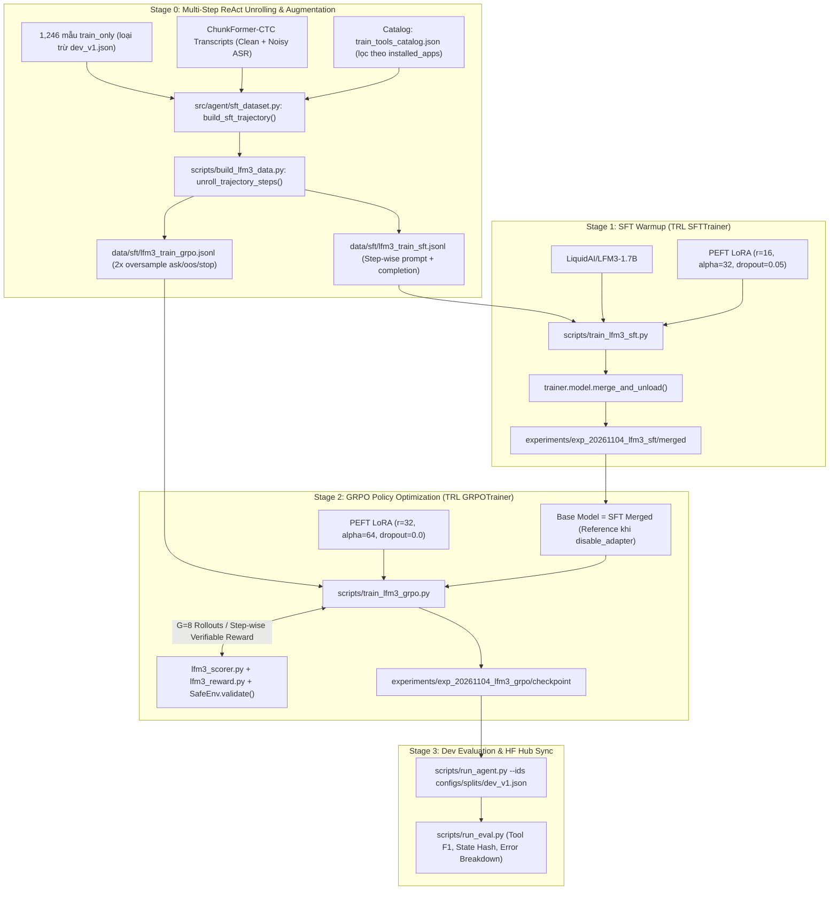

# Spec: LFM3 Post-Training Pipeline (SFT & GRPO) for Zalo AI LifeMate

- **Owner:** AI Engineering Team
- **Date:** 2026-11-04
- **Target Model:** [`LiquidAI/LFM3-1.7B`](https://huggingface.co/LiquidAI/LFM3-1.7B) (1.73B active parameters, Tri-Hybrid Architecture)
- **Reference Gold Codebase:** [`src/lfm3-post-training/`](file:///C:/WORKSPACE/ZALO_AIC/src/lfm3-post-training/) ([`lfm3_sft_with_trl.ipynb`](file:///C:/WORKSPACE/ZALO_AIC/src/lfm3-post-training/lfm3_sft_with_trl.ipynb), [`lfm3_grpo_with_trl.ipynb`](file:///C:/WORKSPACE/ZALO_AIC/src/lfm3-post-training/lfm3_grpo_with_trl.ipynb))
- **Evaluation Split:** `dev_v1` (299 samples, leak-free stratified split at [`configs/splits/dev_v1.json`](file:///C:/WORKSPACE/ZALO_AIC/configs/splits/dev_v1.json))
- **Status:** Approved for Implementation (v2 — Multi-Step ReAct Unrolling & Merged SFT Reference)

---

## 1. Mục Tiêu & Nguyên Tắc Kế Thừa "Golden Code"

### 1.1. Mục tiêu định lượng
1. **Nâng Tool-Call F1 từ 28.99% lên $\ge$ 85–90%** và **State Match Rate từ 28.06% lên $\ge$ 80–85%** trên tập `dev_v1` (299 mẫu).
2. **Duy trì độ trễ suy luận $\le$ 8s / mẫu** (trần quy chế BTC là $\le$ 30s / mẫu).
3. **Tuân thủ tuyệt đối trần quy chế BTC:**
   - Tổng tham số hệ thống ASR + LLM < 6B (`LiquidAI/LFM3-1.7B` 1.73B + `ChunkFormer-CTC-Large-Vie` 146M = **1.88B $\ll$ 6B**).
   - Ngữ cảnh suy luận tối đa $\le$ 16,384 tokens.
   - Tuyệt đối không đọc trực tiếp `<split>_environment/` hay `state.json`; chỉ tương tác qua [`SafeEnv`](file:///C:/WORKSPACE/ZALO_AIC/src/env/safe_env.py).

### 1.2. Nguyên tắc kế thừa 100% từ [`src/lfm3-post-training/`](file:///C:/WORKSPACE/ZALO_AIC/src/lfm3-post-training/)
1. **Model & Tokenizer Loading chuẩn tác giả:**
   - Load tokenizer với `trust_remote_code=True, padding_side="left"`.
   - Load model với `dtype=torch.bfloat16` (hoặc `torch.float16` nếu GPU không hỗ trợ bf16), `device_map="auto", trust_remote_code=True`.
   - Suy luận greedy (`do_sample=False`) kèm `repetition_penalty=1.1` theo đúng [`lfm3_sft_with_trl.ipynb`](file:///C:/WORKSPACE/ZALO_AIC/src/lfm3-post-training/lfm3_sft_with_trl.ipynb#L282) để triệt tiêu hiện tượng lặp chuỗi trong thẻ `<parameter=...>`.
2. **LoRA Target Modules cho kiến trúc Tri-Hybrid LFM3:**
   Target toàn bộ 3 khối cấu thành của LFM3:
   - Attention projections: `["q_proj", "k_proj", "v_proj", "o_proj"]`
   - Gated short convolutions: `["in_proj", "out_proj"]`
   - Feedforward SwiGLU MLP: `["w1", "w2", "w3"]`
3. **Chat Template & Native Tool Parser:**
   - Render prompt bằng `tokenizer.apply_chat_template(messages, tools=tools, add_generation_prompt=True, tokenize=False, enable_thinking=False)`.
   - Giải mã lệnh gọi tool bằng phương thức native `tokenizer.parse_response(completion_ids, prefix=prompt, tools=tools)` kết hợp fallback [`parse_tool_calls`](file:///C:/WORKSPACE/ZALO_AIC/src/agent/tool_caller.py#L273-L283) + ép kiểu schema [`coerce_arguments`](file:///C:/WORKSPACE/ZALO_AIC/src/agent/tool_caller.py#L122-L133).

---

## 2. Kiến Trúc Pipeline 2 Giai Đoạn (Multi-Step ReAct Unrolling + SFT + GRPO)

Trong Zalo AI Challenge LifeMate, **67.7% mẫu hành động là Multi-Step ReAct** (`Read` $\rightarrow$ nhận `tool_result` chứa ID/số tiền/thời tiết $\rightarrow$ `Write`) và **65.9% mẫu có lịch sử hội thoại (`sample.history`)**. Để kết nối hoàn hảo bài toán Multi-Step ReAct của Zalo với cơ chế huấn luyện 1 lượt (`prompt` $\rightarrow$ `completion`) của `SFTTrainer` và `GRPOTrainer` trong [`src/lfm3-post-training/`](file:///C:/WORKSPACE/ZALO_AIC/src/lfm3-post-training/), mỗi quỹ đạo ReAct $K$ bước từ [`build_sft_trajectory`](file:///C:/WORKSPACE/ZALO_AIC/src/agent/sft_dataset.py#L57-L119) được **trải phẳng theo từng bước (Step-wise Unrolling)**:



---

## 3. Thiết Kế Chi Tiết Giai Đoạn 1: SFT Warmup (`SFTTrainer`)

### 3.1. Cơ chế Step-wise Unrolling & Đa dạng hóa nhiễu ASR (`data/sft/lfm3_train_sft.jsonl`)
1. **Bảo toàn ngữ cảnh & bộ lọc công cụ thực tế:**
   - Sử dụng trực tiếp [`build_messages`](file:///C:/WORKSPACE/ZALO_AIC/src/agent/history.py#L65-L100) (giữ đầy đủ `sample.history` và `build_system_prompt`) và [`select_tools(sample, catalog)`](file:///C:/WORKSPACE/ZALO_AIC/src/agent/tool_selector.py#L71-L76) (chỉ lấy các tool thuộc `sample.context["installed_apps"]` + `sys.ask_missing_info`).
2. **Tách quỹ đạo $K$ bước thành $K$ bản ghi `(prompt, completion)`:**
   Với một quỹ đạo chuẩn `messages = [system, ...history..., user_current, asst_1, tool_1, ..., asst_K]`:
   - Ở mỗi bước $t \in \{1 \dots K\}$ mà `messages[idx_t]["role"] == "assistant"`:
     - `prompt_messages = messages[:idx_t]` (chứa câu hỏi của user và toàn bộ kết quả `role="tool"` của các bước đọc $1 \dots t-1$).
     - `completion_message = messages[idx_t]` (chứa các `tool_calls` của bước $t$, hoặc câu xác nhận ngắn gọn khi đã hoàn tất / từ chối OOS).
   - Khi có `tokenizer` của LFM3, pre-render trực tiếp:
     - `prompt = tokenizer.apply_chat_template(prompt_messages, tools=tools, add_generation_prompt=True, tokenize=False, enable_thinking=False)`
     - `full = tokenizer.apply_chat_template(prompt_messages + [completion_message], tools=tools, add_generation_prompt=False, tokenize=False, enable_thinking=False)`
     - `completion = full[len(prompt):]`
   - Nhờ đó, `SFTTrainer` tính **Completion-Only Loss** chính xác 100% trên phần phản hồi của `assistant` ở từng bước mà vẫn giữ nguyên `tools` schema của từng mẫu.
3. **Kết hợp Clean + ChunkFormer-CTC Augmentation:**
   - Mỗi mẫu trong 1,246 mẫu `train_only` được sinh trajectory trên bản **Clean (`audio_text`)**.
   - Nếu bản nhận dạng âm thanh từ `ChunkFormer-CTC` (`experiments/exp_20261104_asr_chunkformer_large/transcripts.jsonl`) khác với bản Clean, sinh thêm bản ghi SFT với câu đầu vào là transcript của `ChunkFormer-CTC` và nhãn đích vẫn là các `tool_calls` chuẩn. Mô hình học trực tiếp cách sửa lỗi đồng âm tiếng Việt (ví dụ: `"tắm rưỡi"` $\rightarrow$ `20:30`, `"vàng sec"` $\rightarrow$ `"sjc"`, `"chuyển hai triệu tám"` $\rightarrow$ `2800000`).

### 3.2. Cấu hình Hyperparameter SFT (Kế thừa [`lfm3_sft_with_trl.ipynb`](file:///C:/WORKSPACE/ZALO_AIC/src/lfm3-post-training/lfm3_sft_with_trl.ipynb))
```python
peft_config = LoraConfig(
    r=16,
    lora_alpha=32,
    lora_dropout=0.05,
    target_modules=[
        "q_proj", "k_proj", "v_proj", "o_proj",
        "in_proj", "out_proj",
        "w1", "w2", "w3",
    ],
    task_type="CAUSAL_LM",
)

sft_config = SFTConfig(
    output_dir="./experiments/exp_20261104_lfm3_sft",
    num_train_epochs=2,
    per_device_train_batch_size=4,
    gradient_accumulation_steps=4,  # effective batch size = 16
    learning_rate=2e-4,
    lr_scheduler_type="cosine",
    warmup_steps=0.05,              # float = tỉ lệ tổng số steps trong TRL 1.16+
    max_length=6144,                # bao phủ trọn vẹn history + installed_apps schemas
    logging_steps=10,
    save_strategy="epoch",
    bf16=use_bf16,
    fp16=not use_bf16,
    report_to="none",
)
```
* **Bước chuyển tiếp bắt buộc cuối SFT:** Gọi `merged_model = trainer.model.merge_and_unload()` và lưu vào `experiments/exp_20261104_lfm3_sft/merged`.

---

## 4. Thiết Kế Chi Tiết Giai Đoạn 2: GRPO Policy Optimization (`GRPOTrainer`)

### 4.1. Khởi tạo từ SFT Merged & Cân bằng dữ liệu (Data Balancing)
1. **Điểm neo KL Penalty (`beta = 0.04`):**
   - Load `experiments/exp_20261104_lfm3_sft/merged` làm `model` đầu vào cho `GRPOTrainer`, và gắn `LoraConfig(r=32, alpha=64, lora_dropout=0.0)` mới lên trên.
   - Khi `GRPOTrainer` gọi `model.disable_adapter()` để lấy phân phối của Reference Model, nó sẽ lấy đúng **mô hình đã qua SFT** (mà không tốn thêm VRAM cho bản copy thứ hai), ngăn chặn tuyệt đối hiện tượng suy thoái chính sách (policy collapse).
2. **Oversampling 2x cho các bước `ask` và `oos`:**
   - Kế thừa trực tiếp kỹ thuật cân bằng từ [`lfm3_grpo_with_trl.ipynb`](file:///C:/WORKSPACE/ZALO_AIC/src/lfm3-post-training/lfm3_grpo_with_trl.ipynb#L498-L500): nhân đôi (`2x`) các bản ghi thuộc nhóm `step_category in ("ask", "oos")` trong tập `lfm3_train_grpo.jsonl` để chống thiên kiến gọi tool bừa bãi khi thiếu thông tin hoặc ngoài phạm vi.

### 4.2. Bộ So Khớp Tham Số (`lfm3_scorer.py`) & Hàm Thưởng Xác Thực (`lfm3_reward.py`)
Kế thừa bộ hàm `norm`, `same_value`, `canonical`, `calls_match`, `tool_name_f1` từ [`lfm3_grpo_with_trl.ipynb`](file:///C:/WORKSPACE/ZALO_AIC/src/lfm3-post-training/lfm3_grpo_with_trl.ipynb#L273-L382) kết hợp với chuẩn chấm điểm chính thức của BTC trong [`src/eval/metrics.py`](file:///C:/WORKSPACE/ZALO_AIC/src/eval/metrics.py) và [`SafeEnv`](file:///C:/WORKSPACE/ZALO_AIC/src/env/safe_env.py):

```python
def compute_step_reward(
    gold_calls: list[dict],
    pred_calls: list[dict],
    catalog: dict[str, dict],
    *,
    is_valid_format: bool = True,
    all_env_valid: bool = True,
) -> float:
    # 1. Trường hợp bước không gọi tool (OOS hoặc Final Stop sau khi hoàn tất)
    if not gold_calls:
        return 1.0 if (not pred_calls and is_valid_format) else 0.0

    # 2. Trường hợp phải gọi tool nhưng không gọi hoặc sai định dạng XML
    if not pred_calls or not is_valid_format:
        return 0.0

    # 3. Khớp hoàn toàn toàn bộ tool_calls của bước (không phụ thuộc thứ tự) và hợp lệ SafeEnv
    if all_env_valid and calls_match(gold_calls, pred_calls, catalog):
        return 1.0

    # 4. Tín hiệu thưởng dẫn hướng liên tục (Dense Partial Credit):
    #    - 0.2 * tool_name_f1 (giống hệt lfm3_grpo_with_trl.ipynb)
    #    - 0.3 * arg_match_f1 (tỉ lệ tham số đúng tên & đúng giá trị theo chuẩn BTC)
    #    - 0.1 * env_valid_bonus (nếu toàn bộ lệnh gọi vượt qua SafeEnv.validate())
    name_score = 0.2 * tool_name_f1(gold_calls, pred_calls)
    arg_score = 0.3 * arg_overlap_f1(gold_calls, pred_calls, catalog)
    env_score = 0.1 if all_env_valid else 0.0
    return min(0.6, name_score + arg_score + env_score)
```

### 4.3. Cấu hình Hyperparameter GRPO (Kế thừa [`lfm3_grpo_with_trl.ipynb`](file:///C:/WORKSPACE/ZALO_AIC/src/lfm3-post-training/lfm3_grpo_with_trl.ipynb))
```python
peft_config = LoraConfig(
    r=32,
    lora_alpha=64,
    lora_dropout=0.0,
    target_modules=[
        "q_proj", "k_proj", "v_proj", "o_proj",
        "in_proj", "out_proj",
        "w1", "w2", "w3",
    ],
    task_type="CAUSAL_LM",
)

grpo_config = GRPOConfig(
    output_dir="./experiments/exp_20261104_lfm3_grpo",
    max_steps=150,
    per_device_train_batch_size=2,
    gradient_accumulation_steps=16,  # 32 rollouts / step (4 prompts x 8 generations)
    num_generations=8,               # Group size G = 8
    generation_batch_size=8,         # 1 group per forward pass to fit 24GB VRAM
    max_completion_length=256,
    temperature=1.0,                 # Exploration diversity within group
    learning_rate=1e-5,
    beta=0.04,                       # KL penalty towards SFT-merged reference model
    lr_scheduler_type="constant_with_warmup",
    warmup_steps=5,
    logging_steps=5,
    save_strategy="steps",
    save_steps=50,
    bf16=use_bf16,
    fp16=not use_bf16,
    report_to="none",
)
```

---

## 5. Cấu Trúc File & Mô-đun Hệ Thống

```text
src/
├── agent/
│   ├── sft_dataset.py        # (Cập nhật) Thêm hỗ trợ ASR injection & unroll_trajectory_steps()
│   ├── llm_client.py         # (Cập nhật) padding_side="left", dtype, repetition_penalty=1.1
│   ├── lfm3_scorer.py        # Bộ so khớp tham số kế thừa lfm3_grpo_with_trl.ipynb + metrics.py
│   ├── lfm3_reward.py        # Hàm thưởng Step-wise Verifiable Reward kết nối SafeEnv
│   ├── lfm3_sft.py           # Cấu hình LoRA (r=16) + SFTTrainer + merge_and_unload()
│   ├── lfm3_grpo.py          # Cấu hình LoRA (r=32) + GRPOTrainer trên nền SFT-merged
scripts/
├── build_lfm3_data.py        # CLI tạo lfm3_train_sft.jsonl & lfm3_train_grpo.jsonl
├── train_lfm3_sft.py         # Entrypoint huấn luyện Stage 1 (SFT) trên Colab GPU
├── train_lfm3_grpo.py        # Entrypoint huấn luyện Stage 2 (GRPO) trên Colab GPU
configs/
├── lfm3_sft.yaml             # Cấu hình huấn luyện SFT
├── lfm3_grpo.yaml            # Cấu hình huấn luyện GRPO
tests/
├── test_lfm3_data.py         # Unit tests cho Step-wise Unrolling & Data Builder
├── test_lfm3_scorer.py       # Unit tests cho Parameter Scorer & Tool Matcher
├── test_lfm3_reward.py       # Unit tests cho Step-wise Verifiable Reward & SafeEnv check
├── test_lfm3_sft.py          # Unit tests cho SFT LoRA & SFTConfig
├── test_lfm3_grpo.py         # Unit tests cho GRPO LoRA & GRPOConfig
```

---

## 6. Tiêu Chí Nghiệm Thu (Acceptance Criteria)

1. **Unit Tests:** 100% các module mới có unit test đầy đủ tại `tests/test_lfm3_*.py` và vượt qua toàn bộ bộ test `pytest -v`.
2. **Leak-Free Guarantee:** Tuyệt đối 0% mẫu trong `configs/splits/dev_v1.json` (299 mẫu) xuất hiện trong `lfm3_train_sft.jsonl` hoặc `lfm3_train_grpo.jsonl`.
3. **SFT Gate:** Sau Stage 1 (SFT 2 epochs), đánh giá trên 299 mẫu `dev_v1` đạt Tool-Call F1 $\ge$ 75% và State Match Rate $\ge$ 65%.
4. **GRPO Gate:** Sau Stage 2 (GRPO 150 steps), đánh giá trên 299 mẫu `dev_v1` đạt Tool-Call F1 $\ge$ 85–90% và State Match Rate $\ge$ 80–85%.
5. **Compliance & Latency Gate:** Tổng tham số kiểm tra qua `scripts/count_params.py` < 6B, độ trễ suy luận trung bình $\le$ 8s / mẫu trên GPU L4.
